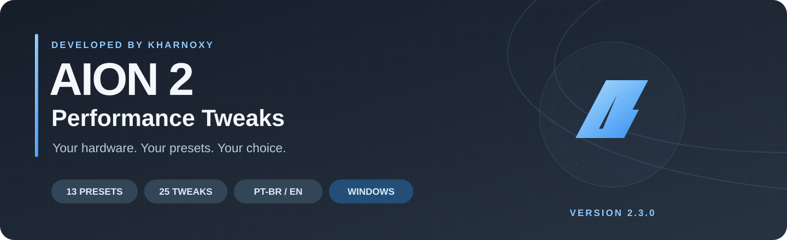
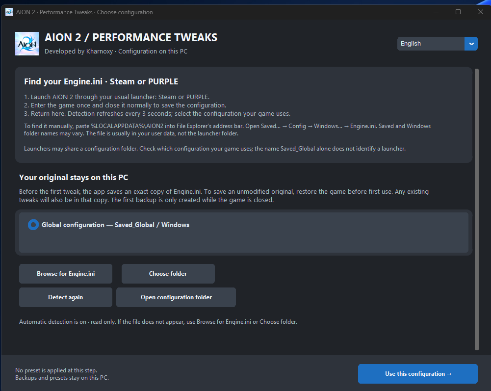
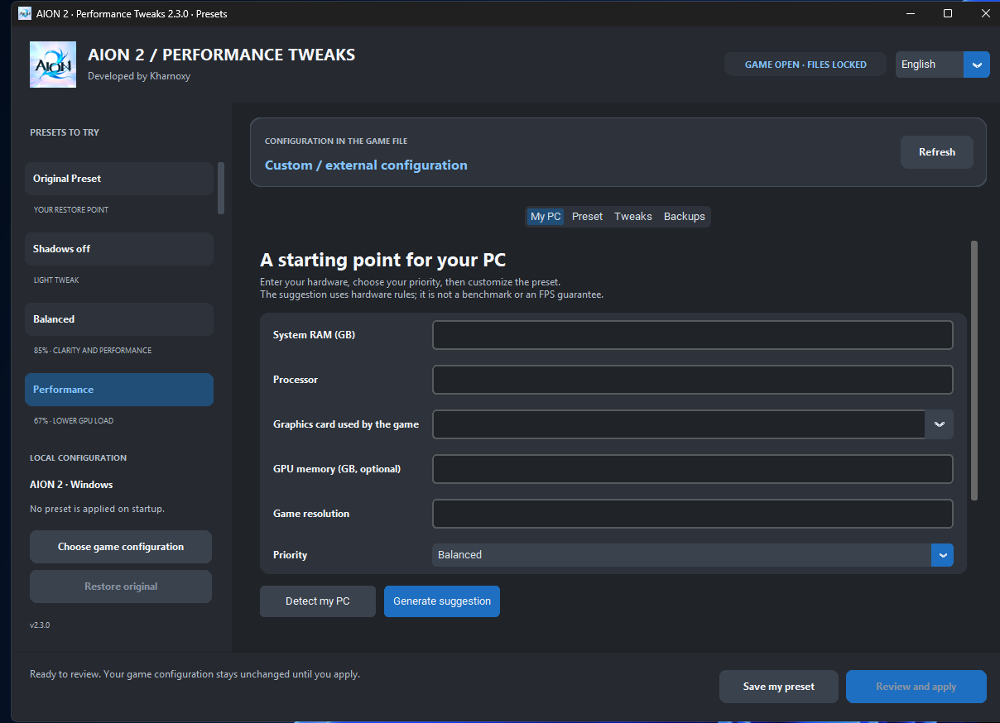
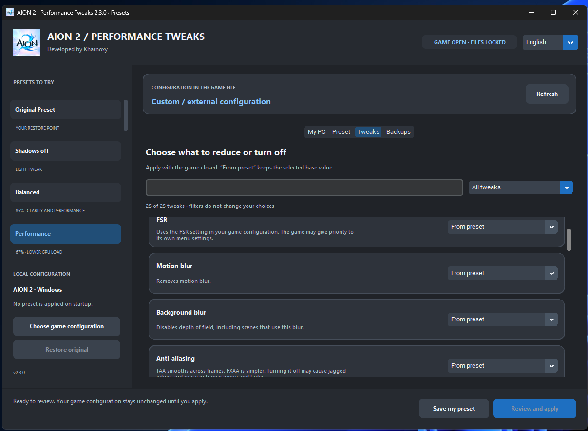

### Ajuste o jogo ao seu PC. Compare presets. Volte ao original quando quiser.

**Aplicativo independente para Windows 10/11 x64 · Português / English**

[⬇ Baixar versão 2.3.0](https://github.com/BrunoMPVieira/AION2-Performance-Tweaks/releases/download/v2.3.0/AION2-Tweak-Desempenho-v2.3.0.zip) · [Ver lançamento](https://github.com/BrunoMPVieira/AION2-Performance-Tweaks/releases/tag/v2.3.0) · [Read in English](README.en.md)

[Apresentação PT-BR](docs/post-pt-br.md) · [English announcement](docs/post-en.md)

## Feito para experimentar com segurança

Nem todo mundo joga em um PC de última geração. **AION 2 — Tweak de Desempenho** reúne opções de `Engine.ini` em uma interface simples para você testar combinações e decidir o que funciona no seu computador. O aplicativo não promete FPS específico e não aplica um preset sem você revisar.

## O que há no aplicativo

- **13 presets prontos**, de Qualidade e Equilibrado a PC modesto, Ultrawide leve · FSR e famoso MODO Massinha experimental.
- **25 controles individuais** para ajustar sombras, blur, escala/FSR, texturas, vegetação, reflexos, iluminação e efeitos.
- **Assistente Meu PC**: detecte ou informe RAM, processador e GPU; escolha a prioridade e revise uma sugestão editável.
- **Presets pessoais** salvos localmente e interface em português ou inglês.
- **Presset Original**: cópia do `Engine.ini` deste PC, com botão **Voltar ao normal** para restaurá-la.

## Começar

1. [Baixe o ZIP da versão 2.3.0](https://github.com/BrunoMPVieira/AION2-Performance-Tweaks/releases/download/v2.3.0/AION2-Tweak-Desempenho-v2.3.0.zip), extraia e abra **AION 2 Tweak de Desempenho.exe**. Python não é necessário.
2. Abra o AION 2 pelo launcher habitual, Steam ou PURPLE, entre uma vez e feche normalmente.
3. Selecione o `Engine.ini` encontrado. Se houver mais de um, escolha a configuração que seu jogo usa.
4. Escolha um preset ou monte uma sugestão em **Meu PC**. Personalize em **Ajustes**.
5. Com o jogo fechado, revise e aplique. Abra o jogo para conferir a mesma cena e salve a combinação se gostar.

A detecção procura configurações locais e atualiza a lista a cada três segundos. Para localizar o arquivo manualmente, cole `%LOCALAPPDATA%\AION2` na barra do Explorador e procure `Saved… → Config → Windows… → Engine.ini`. Também é possível escolher uma pasta ou um arquivo. Os nomes das pastas não identificam sozinhos Steam ou PURPLE.

## Seu caminho de volta

Antes do primeiro ajuste, o app guarda uma cópia exata do `Engine.ini` selecionado neste computador. Os presets seguintes não substituem essa cópia. **Voltar ao normal** restaura o arquivo salvo e mantém cópias de segurança separadas por configuração.

O arquivo salvo é o que já existia no primeiro uso. Se ele continha mods ou ajustes, eles também estarão na cópia. Para começar de uma base sem modificações, restaure o jogo antes da primeira captura. A restauração do app afeta apenas `Engine.ini`.

## Limites conhecidos

As mudanças só entram em vigor na próxima abertura do jogo. A versão do jogo pode ignorar alguns valores; o resultado também depende do hardware e da cena. O assistente é uma sugestão por regras locais, não um benchmark nem uma garantia de FPS.

Os controles experimentais de partículas são globais e podem esconder skills, avisos de ataques e portais. Não há controle verificado para limitar a quantidade de jogadores visíveis. Teste esses ajustes com cuidado; a sugestão automática não oculta partículas globalmente.

## Integridade do download

SHA-256 do ZIP: `9E87DCE730A364308905849C5A63217A76AC8494B631D633F342C8761B65BF92` · [arquivo de checksums](https://github.com/BrunoMPVieira/AION2-Performance-Tweaks/releases/download/v2.3.0/SHA256SUMS.txt)

Problemas e sugestões: [abra uma issue](https://github.com/BrunoMPVieira/AION2-Performance-Tweaks/issues) descrevendo seu hardware e os passos para reproduzir. Não anexe arquivos pessoais de configuração.

**Projeto independente, sem afiliação com a NCSOFT. Desenvolvido por Kharnoxy.**
